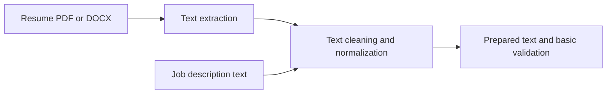

# Resume Matcher Utilities

A Python package foundation for extracting and preparing resume and job-description text.

## Overview

The `resume_matcher` package provides PDF and DOCX text extraction, text cleaning and normalization, basic job-description validation, and configuration helpers. The repository includes unit tests for these utilities.

## Key Features

- Extract text from PDF and DOCX files
- Clean whitespace and normalize text for matching
- Represent and validate job-description text
- Configure model name, file-size limit, and similarity threshold through environment variables

## Tech Stack

Python 3.8+, pypdf, python-docx, spaCy, scikit-learn, sentence-transformers, and pytest.

## Workflow



## Project Structure

```text
.
├── pyproject.toml
├── src/resume_matcher/
│   ├── config.py
│   ├── extractor.py
│   ├── jd.py
│   ├── logger.py
│   └── preprocessor.py
└── tests/
```

## Installation and Execution

Install the package and development dependencies from the repository root:

```bash
python -m pip install -e ".[dev]"
```

Example:

```python
from resume_matcher.extractor import extract_text
from resume_matcher.jd import JobDescription

resume_text = extract_text("resume.pdf")
job = JobDescription("We are looking for a Python developer with testing experience.")
print(job.validate())
```

Run the test suite with:

```bash
pytest
```

## Configuration

Optional environment variables include `RESUME_MATCHER_SPACY_MODEL`, `RESUME_MATCHER_MAX_FILE_SIZE_MB`, and `RESUME_MATCHER_SIMILARITY_THRESHOLD`.

## Author

**Gireesh Sadanand Patgar** · [GitHub](https://github.com/gireeshpatgar17)
